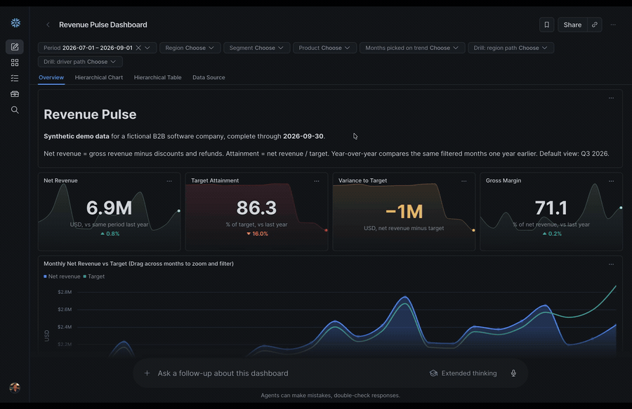

# Getting Started with Snowflake Dashboards

Companion code for both Snowflake Dashboards developer guides:

- **Part 1, *Getting Started with Snowflake Dashboards*:** everything is in [`getting-started/`](getting-started/). Run `setup.sql`, upload `revenue_pulse.dash`, and explore a working dashboard in a few minutes.
- **Part 2, *Build Snowflake Dashboards with CoCo*:** build the same dashboard from scratch.

Both parts use the same synthetic Revenue Pulse data. Part 1 gets a finished dashboard running in a few minutes, and Part 2 shows how to build it yourself with Cortex Code. The sections below give a quick-reference version of each.

### See it in action

Revenue Pulse tracks a fictional B2B software company's net revenue against target, broken down by month, region, segment, account, and product. It's built with [Snowflake Dashboards](https://docs.snowflake.com/en/LIMITEDACCESS/cowork-dashboards), where every chart is also a filter through [chart actions](https://docs.snowflake.com/en/LIMITEDACCESS/cowork-dashboards#chart-actions). Click a chart and the rest of the dashboard filters to match:

## Part 1: Deploy the ready-made dashboard

Get the finished Revenue Pulse dashboard running in a few minutes, explore its chart actions and drill-downs, then ask CoWork why the numbers moved.

**You need:** a schema you can create tables and semantic views in, and a warehouse. No admin role.

1. Point the files in [`getting-started/`](getting-started/) at your schema.
2. Run `setup.sql` in a workspace to load the data and semantic view.
3. Upload and open `revenue_pulse.dash`.
4. When you're done, run `cleanup.sql`.

The [guide](https://github.com/sfc-gh-cnantasenamat/sfguide-getting-started-with-snowflake-dashboards) has the full walkthrough and expected numbers.

### Optional: OSSIE variant

[`getting-started-ossie/`](getting-started-ossie/) is the same setup with the semantic view defined in open [Apache Ossie](https://docs.snowflake.com/en/sql-reference/stored-procedures/system_create_semantic_view_from_ossie_yaml) YAML instead of native DDL. Use it in place of `getting-started/`; the dashboard returns the same results.

## Part 2: Build the dashboard with CoCo

Build the same dashboard yourself by prompting Cortex Code, publish it to a sales-ops role, and ask follow-up questions in CoWork.

**You need:** `ACCOUNTADMIN` (setup creates a database, a Git integration, and a viewer role) and a warehouse.

1. Run the SQL scripts in [`sql/`](sql/) in order, starting with `00_bootstrap.sql`.
2. Open this repo as a Git workspace.
3. Prompt Cortex Code to build your own dashboard, using `dashboards/revenue_pulse.dash` as the reference.
4. Publish it as an artifact and share it.

The [guide](https://github.com/sfc-gh-cnantasenamat/sfguide-build-snowflake-dashboards-with-coco) has the prompts, checks, and screenshots for each step.

## References

- [Dashboards in Snowsight and Snowflake CoWork](https://docs.snowflake.com/en/LIMITEDACCESS/cowork-dashboards): Snowflake Dashboards documentation
- [Chart actions](https://docs.snowflake.com/en/LIMITEDACCESS/cowork-dashboards#chart-actions): how clicking or dragging on a chart filters other tiles
- [SYSTEM$CREATE_SEMANTIC_VIEW_FROM_OSSIE_YAML](https://docs.snowflake.com/en/sql-reference/stored-procedures/system_create_semantic_view_from_ossie_yaml): used by the OSSIE variant
